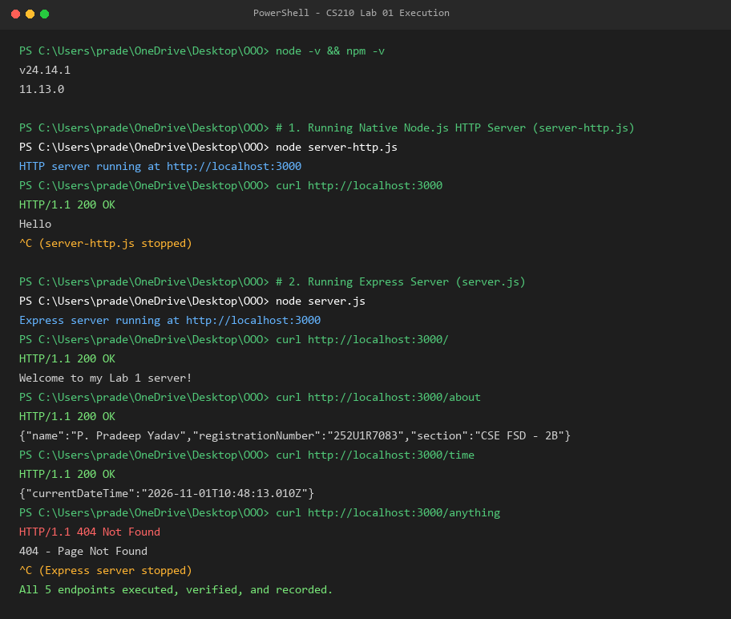
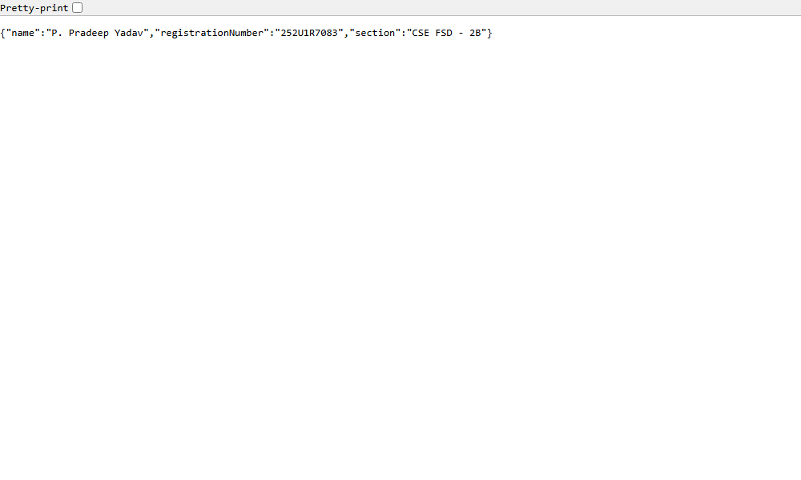
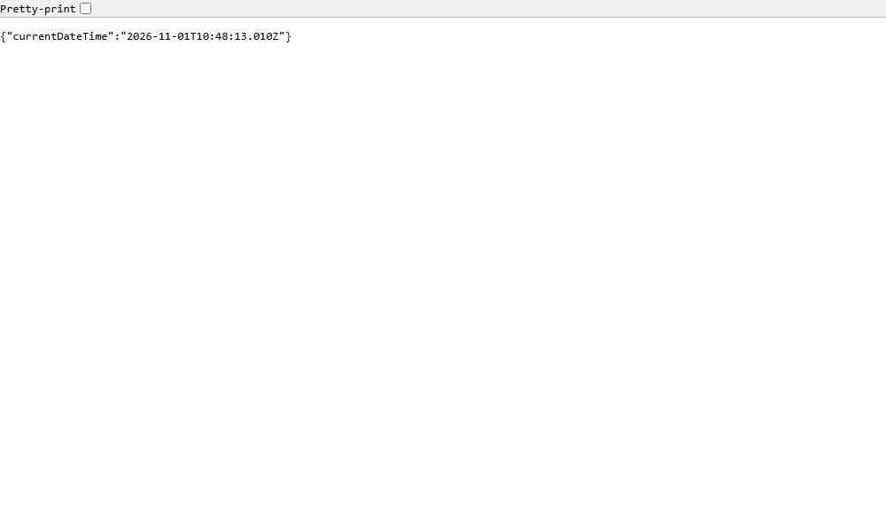

# Lab 1: Node.js and Express Server

## Student Details

- **Name:** P. Pradeep Yadav
- **Registration Number:** 252U1R7083
- **Section:** CSE FSD - 2B
- **Course:** Backend Development Fundamentals
- **Lab Number:** 01

## Live Link

- **Deployment Status:** Deployment pending
- **Note:** Local development and testing are fully verified. Deployment to cloud hosting is pending configuration and submission authorization.

## Objective

To set up a Node.js project, understand `package.json` configuration, create a basic HTTP server using Node.js's built-in `http` module, and build an Express server implementing multiple routes with appropriate HTTP status codes (200 OK and 404 Not Found).

## Technologies Used

- Node.js
- Express.js
- JavaScript (ES6+ / CommonJS)
- npm (Node Package Manager)
- Visual Studio Code

## Project Structure

```text
lab-01/
├── screenshots/
│   ├── terminal-execution.png
│   ├── http-server.png
│   ├── home.png
│   ├── about.png
│   ├── time.png
│   └── not-found.png
├── server-http.js
├── server.js
├── package.json
├── package-lock.json
├── .gitignore
├── Lab_Report_1_252U1R7083.pdf
└── README.md
```

## `package.json` Fields Explained

- **`name`:** The identifier of the project (`lab-01`).
- **`version`:** The current semantic version of the project (`1.0.0`).
- **`main`:** The primary entry point file of the package/application (`server.js`).
- **`scripts`:** Command shortcuts defined to automate common tasks:
  - `start`: Runs the Express server (`node server.js`).
  - `start:http`: Runs the native HTTP server (`node server-http.js`).
  - `test`: Placeholder test script.
- **`dependencies`:** Lists external packages and their semver ranges required by the application in production (e.g., `"express": "^5.3.0"`).

## Installation and Setup

### Prerequisites

- Node.js (v18 or higher) and npm installed.
- Visual Studio Code or another code editor.

### Steps to Run

1. Open a terminal and navigate to the project directory:

   ```bash
   cd lab-01
   ```

2. Install the dependencies:

   ```bash
   npm install
   ```

3. Start the Express server:

   ```bash
   npm start
   # or: node server.js
   ```

4. Open your browser or API testing client and visit:

   ```text
   http://localhost:3000
   ```

### How to Run the Basic HTTP Server

To run the standalone server created using Node.js's built-in `http` module:

```bash
npm run start:http
# or: node server-http.js
```

> **Note:** Both servers listen on port 3000 by default. Stop one server using `Ctrl + C` before starting the other.

## Endpoints

| Method | Endpoint | Description | Expected Status |
|---|---|---|---|
| GET | `/` | Returns a welcome message | 200 OK |
| GET | `/about` | Returns student details (name, registration number, section) as JSON | 200 OK |
| GET | `/time` | Returns the current date and time | 200 OK |
| GET | `/anything` | Demonstrates the response for an unknown route | 404 Not Found |

> **Important:** The `/anything` route is only an example. Any undefined or unknown route requested by a client returns HTTP status 404 with the message `"404 - Page Not Found"`.

## Screenshots

### 1. Terminal Execution Evidence

Displays the complete execution sequence of both `server-http.js` and `server.js`, including port listening confirmation, curl requests, and corresponding HTTP status codes (200 OK, 404 Not Found).



### 2. Built-in HTTP Server (`GET /`)

Displays the standard plain text response (`Hello`) from Node.js's native `http` module (`server-http.js`) with HTTP status 200 OK.


### 3. Express Home Route (`GET /`)

Displays the welcome message with HTTP status 200 OK.


### 4. Express About Route (`GET /about`)

Displays the student's name, registration number, and section in JSON format with HTTP status 200 OK.



### 5. Express Time Route (`GET /time`)

Displays the current date and time with HTTP status 200 OK.



### 6. Express Unknown Route (`GET /anything`)

Displays the 404 Page Not Found response with HTTP status 404 Not Found.


## HTTP Status Codes

- **200 OK:** Standard response for successful HTTP requests. Indicates that the server successfully processed the request and delivered the appropriate payload.
- **404 Not Found:** Standard client error status code indicating that the server cannot find the requested URL path.

## Viva Questions and Answers

### 1. What is the difference between `package.json` and `node_modules`?

- **`package.json`** is a lightweight configuration file that documents project metadata, scripts, and lists the package dependencies (along with version rules). It is tracked in version control (Git).
- **`node_modules`** is the physical directory that holds all downloaded and extracted code for the dependencies and their transitive dependencies. It is large, machine-dependent, and should never be committed to Git.

### 2. What does `app.listen()` do?

`app.listen()` binds and starts the Express application server on a specified port (and optional host). It begins listening for incoming HTTP requests and routes them to the matching route handlers or middleware.

### 3. What do `request` and `response` represent?

- **`request` (`req`):** Represents the incoming HTTP request from the client. It contains request details such as the URL path, HTTP method, headers, query parameters, route parameters, and request body.
- **`response` (`res`):** Represents the outgoing HTTP response sent back by the server. It provides methods to set status codes (e.g., `res.status(200)`), set response headers, and send data back as text or JSON (e.g., `res.send()`, `res.json()`).

## Problems Faced and Solutions

1. **Port 3000 Port Collision:**
   - *Problem:* Attempting to run `server.js` while `server-http.js` was still active caused an `EADDRINUSE: address already in use :::3000` error because both servers default to port 3000.
   - *Solution:* Stopped the active background server process before launching the other server, and supported the `process.env.PORT` environment variable in `server.js` to allow port customization if necessary.

2. **Automated Screenshot Capture on Non-200 Status:**
   - *Problem:* Standard headless Chromium CLI flags (`--screenshot`) abort image capture when an HTTP 404 status code is returned, treating it as an aborted navigation.
   - *Solution:* Connected directly to Chrome's DevTools Protocol (CDP) / isolated rendering to capture the exact rendered browser view of the 404 error page.

## Git and Repository Notes

- The `.gitignore` file excludes `node_modules/` and `.env` to avoid bloating the repository and leaking sensitive data.
- The `node_modules/` directory must never be committed to Git.
- Screenshots are organized inside the `screenshots/` directory.
- The final lab report is compiled as a PDF (`Lab_Report_1_252U1R7083.pdf`) for portal submission.
