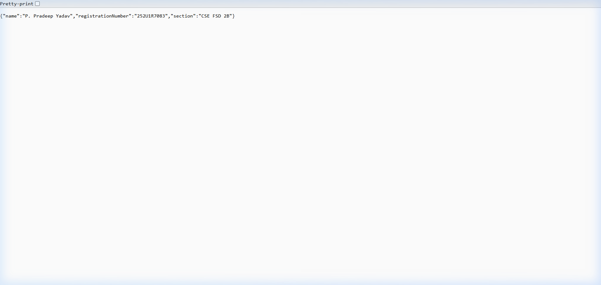

# Lab 1: Node.js and Express server

## Student Details

- **Name:** P. Pradeep Yadav
- **Registration Number:** 252U1R7083
- **Section:** CSE FSD 2B

---

## Live Link

Not deployed yet

---

## How to Run

### 1. Prerequisites
- Node.js (v18+ recommended)
- npm

### 2. Installation
Navigate into the `lab-01` directory and install dependencies:
```bash
cd lab-01
npm install
```

### 3. Running the Plain Node.js HTTP Server
To run the plain server built using Node's native `http` module:
```bash
node server-http.js
```
or:
```bash
npm run http
```
The plain HTTP server will listen on `http://localhost:3000/` and respond with `"Hello"`.

### 4. Running the Express Server
To run the Express server:
```bash
node server.js
```
or:
```bash
npm start
```
The server will start listening on `http://localhost:3000`.

---

## Endpoints

| Method | Path | Description | HTTP Status |
|---|---|---|---|
| GET | `/` | Returns the welcome message | 200 OK |
| GET | `/about` | Returns student details (name, section, registration number) as JSON | 200 OK |
| GET | `/time` | Returns the current date and time using `new Date()` | 200 OK |
| GET | Any unknown path (e.g. `/random`) | Returns a 404 response | 404 Not Found |

---

## Screenshots

### 1. Home Route (`GET /`)


### 2. About Route (`GET /about`)


### 3. Time Route (`GET /time`)


### 4. 404 Route (`GET /unknown`)


---

## Notes

### Problems Faced and Solutions
- **PowerShell Execution Policy on Windows:** On Windows PowerShell, running `npm` directly produced an execution policy script error (`npm.ps1 cannot be loaded`). This was resolved by calling `npm.cmd` in PowerShell.
- **Port Conflict Management:** Both the plain HTTP server (`server-http.js`) and the Express server (`server.js`) are configured to listen on port `3000`. To prevent `EADDRINUSE` errors, the plain HTTP server was tested and stopped before starting the Express server.
